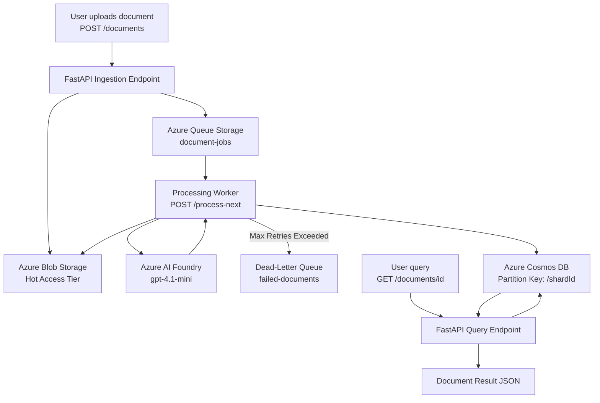
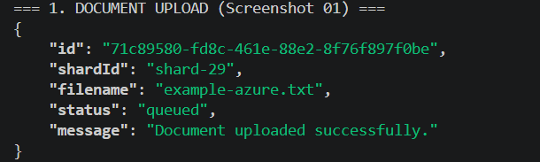
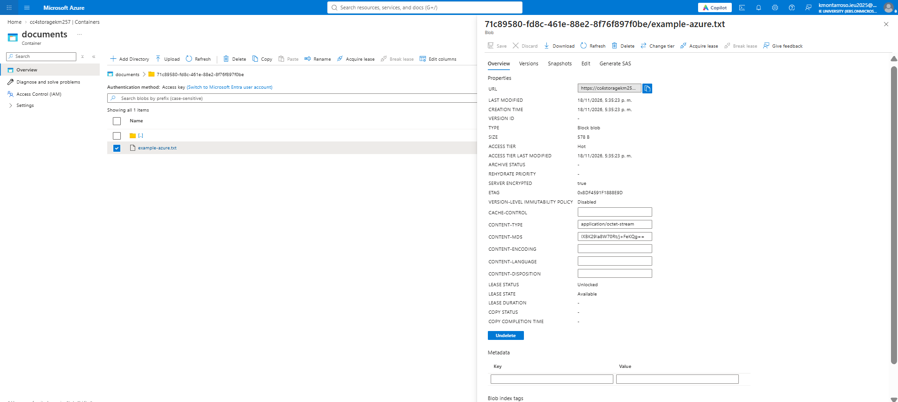
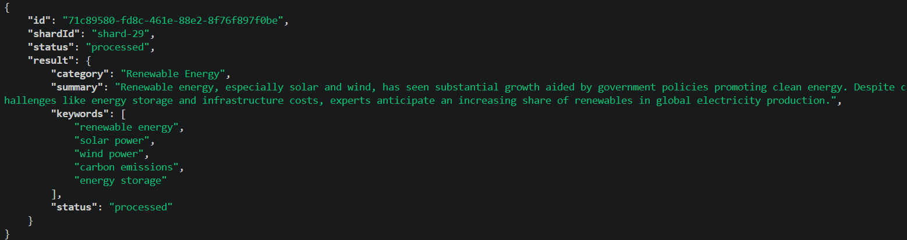
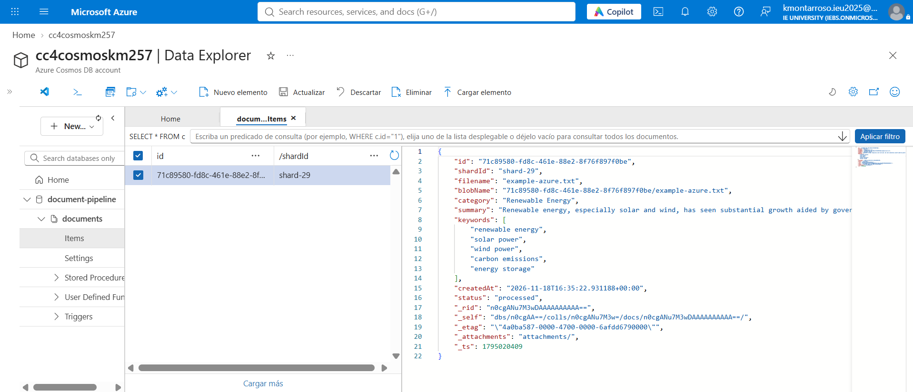
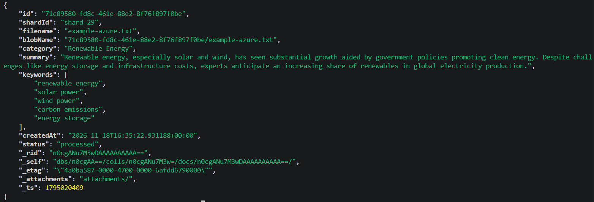
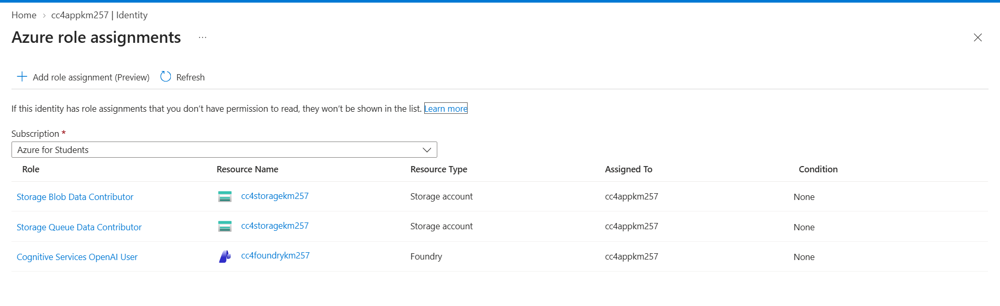

# Assignment 4 — Data Pipeline and Scale

**Name:** K. Montarroso · **Campus:** Madrid  
**Course:** Cloud Computing · **Repository:** `cc-assignment-4`  
**Cloud Provider:** Microsoft Azure (`swedencentral` & `norwayeast`) · **Stack:** FastAPI + Azure Blob/Queue Storage + Cosmos DB + Azure AI Foundry

---

## 1. Overview

This project implements a document-processing pipeline using **Azure Blob Storage**, **Azure Queue Storage**, **Azure Cosmos DB for NoSQL**, **Azure AI Foundry**, and a **Python FastAPI** application hosted on **Azure App Service**.

The system accepts text documents via `POST /documents`, stores the original files in Azure Blob Storage (`Hot` access tier), and places processing jobs in Azure Queue Storage. The next queued document is processed when an operator calls `POST /process-next`. This endpoint downloads the original document, calls an Azure AI Foundry `gpt-4.1-mini` deployment to extract structured fields (`category`, `summary`, and `keywords`), and persists the results in Cosmos DB.

A query endpoint (`GET /documents/{document_id}`) retrieves processed records using a Cosmos DB point read with the document's partition key.

The queue decouples document ingestion from AI processing, but the demonstration uses a manually triggered worker endpoint rather than an automatically running background worker.

All service-to-service authentication uses **Microsoft Entra ID** (`DefaultAzureCredential` with Azure CLI locally and a System-Assigned Managed Identity in Azure)—with **zero account keys or secrets** stored in code or configuration.

---

## 2. Architecture



> **Worker execution:** The processing worker is manually triggered
> through `POST /process-next` in this demonstration. The queue
> provides decoupling and retry handling, but automatic continuous
> processing would require a separately hosted worker or queue-triggered
> function.

### Azure Services & Responsibilities

| Component | Azure Service | Responsibility |
| :--- | :--- | :--- |
| **Application** | Azure App Service (`B1` Linux, Python 3.12) | Hosts the FastAPI ingestion, worker, and query API |
| **File Storage** | Azure Blob Storage (`StorageV2`, `Hot` tier) | Stores original uploaded text documents |
| **Queue** | Azure Queue Storage (`document-jobs` & `failed-documents`) | Decouples ingestion from AI latency/rate limits and captures poison messages |
| **Database** | Azure Cosmos DB for NoSQL (Serverless demo, `/shardId`) | Stores extracted metadata, summaries, and keywords |
| **AI Service** | Azure AI Foundry (`gpt-4.1-mini`, `10,000` TPM) | Performs document summarisation, classification, and keyword extraction |
| **Authentication** | Microsoft Entra ID (`DefaultAzureCredential`) | Keyless RBAC authentication via App Service Managed Identity |

---

## 3. Authentication & Storage Decisions


### Keyless Authentication

The application uses Microsoft Entra ID authentication through `DefaultAzureCredential` for the Azure Blob Storage, Queue Storage, and Cosmos DB SDK clients. The OpenAI client uses a bearer token provider created from the same credential.

- **Local development:** `DefaultAzureCredential` authenticates using the developer's Azure CLI session after running `az login`.
- **Azure deployment:** `DefaultAzureCredential` uses the App Service System-Assigned Managed Identity.

The managed identity is assigned the following data-plane roles:

- `Storage Blob Data Contributor`
- `Storage Queue Data Contributor`
- `Cognitive Services OpenAI User`
- `Cosmos DB Built-in Data Contributor`

The application does not store storage account keys, Cosmos DB keys, or AI API keys in its source code. The `.env` file contains resource endpoints and configuration values, not credentials.

For the OpenAI v1 endpoint, the token provider requests the `https://ai.azure.com/.default` scope.

### Storage Access Tier (`Hot`)
The Blob Storage account and uploaded document blobs explicitly use the **`Hot` access tier**. Newly uploaded documents are read immediately by the processing worker (`POST /process-next`), making frequent initial access guaranteed. While `Cool` or `Cold` tiers offer lower per-GB storage rates, they carry higher read operation costs and a 30-day (`Cool`) or 90-day (`Cold`) minimum retention penalty—making `Hot` the most cost-effective tier for active ingestion pipelines (with lifecycle management rules suitable for moving aged documents to `Cool` after 30 days). The Hot tier was selected because uploaded documents are read shortly after ingestion. Cool or Cold tiers may reduce storage costs for infrequently accessed data, but introduce additional access costs and minimum-retention considerations. A lifecycle management policy could be introduced in a future production version to move older documents to a cooler tier.

### AI Rate Limits, Latency & Failure Handling
* **Latency decoupling**: `POST /documents` returns immediately after persisting the blob and enqueueing a lightweight job message, isolating upload clients from multi-second LLM inference latency.
* **Rate limits (`HTTP 429`)**: The OpenAI client retries transient errors (`max_retries=2`), and explicit `RateLimitError` exceptions inspect `retry-after-ms` / `Retry-After` headers to delay queue message visibility (`update_message(..., visibility_timeout=retry_delay)`) rather than hammering the endpoint.
* **At-least-once persistence & dead-lettering**: The queue message is deleted **only after** `cosmos_container.upsert_item(...)` succeeds. If a job fails `3` times (`dequeue_count >= 3`), it is moved to the `failed-documents` queue for inspection instead of being silently dropped.

---

## 4. Part C — Design for Scale

### 4.1 Partitioning
The Cosmos DB container uses **`/shardId`** as its partition key. When a document is created, the application hashes its UUID with SHA-256 and computes `int(sha256(id), 16) % 64`, producing 64 evenly distributed logical partition values (`shard-00` through `shard-63`).

The primary query pattern is retrieving a single processed document by ID:
```http
GET /documents/{document_id}
```
Because `shardId` is deterministically derived from `document_id`, the API executes a direct **point read** (`read_item(item=document_id, partition_key=shard_id)`), routing directly to the target partition without fan-out.

At **500 GB** of total data, an even distribution across 64 logical partition-key values gives: 

$$ \frac{500\text{ GB}}{64\text{ logical partition keys}} \approx 7.81\text{ GB per logical partition} $$

This is below Cosmos DB's **20 GB per logical partition** storage limit. This estimate assumes that data and index storage are distributed approximately evenly across the 64 values. Hashing helps distribute writes, but does not guarantee perfectly equal storage or traffic.

The 64 values are logical partition-key values, not 64 guaranteed physical partitions. Cosmos DB manages the mapping of logical partitions to physical partitions. The distribution and throughput of the physical partitions must therefore be monitored separately.

**Which query this choice makes slow:** Analytical or filtered queries that do not specify `document_id`—such as *"find all documents where `category == 'Renewable Energy'`"* or *"list the 50 most recent documents across all users"*—cannot compute a single `shardId`. They must perform a **cross-partition fan-out query** across all 64 shards, increasing Request Unit (RU) consumption and tail latency.

### 4.2 The Bottleneck
At scale, the ingestion path and the read path have distinct bottlenecks, with **Azure AI Foundry saturating first during ingestion**:

* **Ingestion bottleneck (Azure AI Foundry TPM quota):**
  * **Measured quota**: My `gpt-4.1-mini` deployment in `swedencentral` has an allocated quota of **`10,000` tokens per minute (TPM)** (`sku.capacity = 10`).
  * **Measured token usage**: Processing `example.txt` logged **`270` total tokens** (`181` input tokens + `89` output tokens).
  * **Maximum sustainable ingestion throughput**:
    $$\frac{10{,}000\text{ tokens/min}}{270\text{ tokens/document}} \approx 37.04\text{ documents/minute} \approx 0.62\text{ documents/second}$$
  * Any sustained upload rate above **37 documents/minute** saturates the AI model quota, causing HTTP `429` throttling and growing backlog depth in `document-jobs`.


* **Read bottleneck (Cosmos DB RU/s at 50,000 QPS):**
  * The `GET /documents/{document_id}` endpoint performs a point read using both the item ID and its partition key. For an approximately 1 KB item, I use **1 RU per read as a planning estimate**. Actual consumption should be verified using Cosmos DB request charge measurements.
  * At this estimate, sustaining **50,000 point reads per second** requires approximately **50,000 RU/s**.
  * The demonstration uses Serverless Cosmos DB, which is suitable for variable, low-volume workloads but does not provide the predictable throughput guarantees required for this target. Serverless capacity is limited per physical partition, and aggregate capacity depends on the number of physical partitions.
  * A production deployment targeting 50,000 QPS should use provisioned or autoscale throughput, validate actual RU consumption, and monitor physical partition distribution. The application compute layer would also need to scale horizontally beyond a single B1 App Service instance.

### 4.3 A Pattern That Helps: Event-Driven Queue
The pipeline uses **Azure Queue Storage** (`document-jobs`) between `POST /documents` and `POST /process-next`.

* **What it fixes:**
  1. **Absorbs traffic spikes**: Sudden upload bursts write quickly to Blob Storage and Queue Storage without overwhelming the `10,000` TPM AI deployment.
  2. **Isolates latency**: Upload callers receive an immediate `200 OK` (`status: "queued"`) instead of blocking on LLM generation.
  3. **Enables safe retries**: Transient AI failures or `429` rate limits leave the message in the queue for delayed retry rather than failing the user's upload.
* **What it costs:**
  1. **Eventual consistency & processing latency**: Immediately after `POST /documents`, `GET /documents/{id}` returns `404` until the worker finishes processing the queued job.
  2. **Operational complexity**: Requires managing queue visibility timeouts, idempotent database upserts, poison-message detection, and monitoring the `failed-documents` dead-letter queue.
  3. **Additional infrastructure & cost**: Introduces an extra managed resource and storage transactions per message enqueue/dequeue cycle.

### 4.4 Placement
Referring to **Session 2 (Cloud Regions vs. Edge)**, **no part of this pipeline belongs at the edge; the entire pipeline should remain inside a cloud region** (ideally co-located in the same region, such as `swedencentral`).

* **Justification**: Every stage relies on stateful, centralized regional services—durable Blob Storage, Queue Storage, Cosmos DB, and managed model inference in Azure AI Foundry. Placing compute at the edge would introduce wide-area network round-trips back to the regional database and AI model without reducing end-to-end processing time.
While an edge CDN/API gateway could terminate TLS closer to globally distributed uploaders, the payloads are tiny text documents processed asynchronously, so regional hosting minimizes inter-service latency, simplifies Entra ID RBAC, and avoids edge complexity.

---

## 5. Running Locally & End-to-End Test

### Prerequisites
* Python 3.12+, Azure CLI (`az`), and an Azure subscription with RBAC permissions assigned to your Entra ID user (`Storage Blob Data Contributor`, `Storage Queue Data Contributor`, `Cognitive Services OpenAI User`, and `Cosmos DB Built-in Data Contributor`).

### Local Setup

Clone the repository:

```bash
git clone https://github.com/Obsidian-257/cc-assignment-4.git
cd cc-assignment-4
```

Create and activate a Python virtual environment:

```bash
python -m venv .venv
```

On Windows PowerShell:

```powershell
.venv\Scripts\Activate.ps1
```

On macOS/Linux:

```bash
source .venv/bin/activate
```

Install dependencies:

```bash
pip install -r requirements.txt
```

Authenticate with Azure:

```bash
az login
```

Create a local environment file and populate it with the resource endpoints from your Azure deployment:

```bash
cp .env.example .env
```

On Windows PowerShell, use:

```powershell
Copy-Item .env.example .env
```

Run the API locally:

```bash
uvicorn app.main:app --reload
```

The API documentation is available at:

`http://127.0.0.1:8000/docs`


### Azure App Service Deployment

The FastAPI application is hosted on Azure App Service using the
Linux Python 3.12 runtime.

The App Service uses a System-Assigned Managed Identity to authenticate
with Blob Storage, Queue Storage, Cosmos DB, and Azure AI Foundry.

#### 1. Configure the application settings

The following application settings must be configured in App Service:

- `AZURE_STORAGE_ACCOUNT_URL`
- `AZURE_BLOB_CONTAINER`
- `AZURE_QUEUE_ACCOUNT_URL`
- `AZURE_QUEUE_NAME`
- `AZURE_FAILED_QUEUE_NAME`
- `COSMOS_ENDPOINT`
- `COSMOS_DATABASE`
- `COSMOS_CONTAINER`
- `AI_ENDPOINT`
- `AI_MODEL`

These settings contain service endpoints and application configuration.
Authentication is provided by the managed identity, not by stored keys.

#### 2. Configure the startup command

For the Python 3.12 runtime, configure Gunicorn with Uvicorn workers:

```bash
gunicorn -w 2 -k uvicorn.workers.UvicornWorker \
  -b 0.0.0.0:8000 app.main:app
```

#### 3. Verify the deployment

After deployment, check the health endpoint:

```text
https://YOUR_APP_NAME.azurewebsites.net/health
```

A successful response should return:

```json
{
  "status": "healthy",
  "service": "document-processing-pipeline"
}
```

The application also exposes interactive API documentation at:

`https://YOUR_APP_NAME.azurewebsites.net/docs`

### End-to-End Pipeline Flow

The following sequence demonstrates the document-processing pipeline.

1. **Health check:** `GET /health` verifies that the API is running.

2. **Upload document:** `POST /documents` accepts a filename and document content. The original document is saved in Blob Storage, 
   and a processing job is added to the `document-jobs` queue.

3. **Process queued job:** An operator calls `POST /process-next`. The application retrieves one queue message, downloads the original document, calls Azure AI Foundry, validates the extracted fields, and saves the result in Cosmos DB.

4. **Query processed document:** `GET /documents/{id}` retrieves the processed record using its ID and deterministically calculated partition key.

5. **Failure handling:** Temporary processing failures leave the job in the queue for retry. After three unsuccessful attempts, the job is moved to `failed-documents`.

The worker is manually triggered in this demonstration. A production implementation could use a continuously running worker or an event-triggered Azure Function to process queue messages automatically.

---

## 6. Evidence

1. **Document Uploaded (`POST /documents`)**  
   

2. **Original Document in Azure Blob Storage (`Hot` Tier)**  
   

3. **AI Processing Completed (`POST /process-next`)**  
   

4. **Saved Record in Cosmos DB (`Data Explorer` with `/shardId`)**  
   

5. **Query Endpoint Returning Processed Record (`GET /documents/{id}`)**  
   

6. **App Service System-Assigned Managed Identity & RBAC Role Assignments**  
   

---

## 7. Cleanup
After capturing all evidence, the entire Azure resource group (`cc-assignment-4-rg`) was deleted (`az group delete --name cc-assignment-4-rg --yes --no-wait`) and verified via `az group exists --name cc-assignment-4-rg` returning `false` so zero ongoing costs remain.

---

## AI Use Disclosure
I acknowledge the use of OpenAI ChatGPT (https://chatgpt.com) and Google Gemini (https://google.com) in completing this assignment. ChatGPT was used to generate the initial project guide and architecture structure, and Google Gemini was used to assist with implementing the FastAPI endpoints, configuring keyless Entra ID and Managed Identity RBAC permissions, troubleshooting Azure deployment and model quotas, verifying resource cleanup, and structuring the Part C scale calculations. All Azure deployments, API executions, token measurements, and screenshots were performed and verified directly in my own environment.